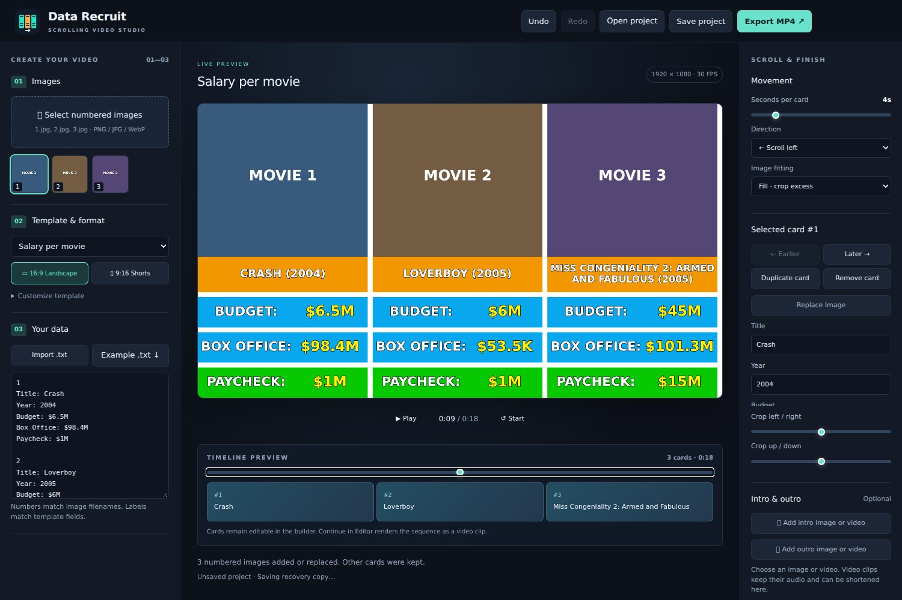

# Data Recruit

Create scrolling image-and-data videos. Built by Clatasha on the Reaction Station editor (OpenScreen, MIT).



## Creating a video

1. Select numbered images: `1.jpg`, `2.jpg`, or `01 - Movie.jpg`.
2. Choose **Salary per movie**, **Facts & comparisons**, or save your own template.
3. Choose **16:9 Landscape** or **9:16 Shorts**.
4. Import a numbered `.txt` file and click **Build Timeline**.
5. Preview, change speed/direction, adjust image crops, and export an MP4 at 720p, 1080p or 1440p and 24, 30 or 60 FPS.

Example text (each field maps to its own template section regardless of order):

```text
1
Title: Crash
Year: 2004
Budget: $6.5M
Box Office: $98.4M
Paycheck: $1M

2
Title: Loverboy
Year: 2005
Budget: $6M
Box Office: $53.5K
Paycheck: $1M
```

Missing fields, duplicate numbers and unmatched images are reported before building. Titles wrap and shrink to fit their section. Images retain their aspect ratio: **Fill** crops, **Fit** adds a dark background. Each image has horizontal and vertical crop controls.

Templates can have 1–6 named rows, each with background and value colors. Adjust fonts, text size, outlines, spacing and image height. Save, rename and delete custom templates for reuse. Salary is a starting preset, not a restriction on content.

**Save project** opens a native Save As dialog on desktop (a JSON download in browser preview). It confirms the write before marking the project saved. The JSON contains the data, template, card images, crop settings, format, export options, card order and bookend settings. Desktop intro/outro imports are copied into Data Recruit’s media folder and referenced by ID, so large videos are not embedded in the JSON. **Open project** restores them on the same computer; moving projects to another computer requires reimporting the intro/outro media. Existing projects with embedded media remain supported. The builder also autosaves a recovery copy locally and offers to restore it on the next launch. Unsaved changes trigger a close warning. Undo and Redo cover card, template and media edits.

Optional intro/outro slots accept images or videos, with no 100 MB desktop import cap. Large desktop videos are copied on disk, decoded on demand in bounded chunks, and keep working if the original is moved. Audio export decodes only the selected trim. Images have adjustable duration; videos play with their original audio, have start/end trimming, volume and mute controls. **Continue in Editor** renders the sequence into a video clip in the inherited editor, where you can make more complex edits with narration, text and other media. **Return to builder** keeps your card setup available during the session. Rebuilds create a new editor project; they do not overwrite earlier edits.

## Number badges and music

Enable **Card number badges** for top-right circles. Choose count up or count down, leave the starting number empty for automatic numbering, or enter your own start. Badge numbers follow the current timeline order rather than image filenames. Size and colors are saved with the template, for landscape and Shorts.

The builder's compact **Music / Audio** timeline accepts multiple files through **＋ Add audio** or file drop. Files selected together are placed consecutively starting at the playhead. Drag waveforms to reposition them; overlapping clips play together. Select a clip to trim its source start/end, change timeline position and duration, set export volume or mute, add fades, loop the trimmed source to fill the video, split at the playhead, duplicate or delete. Audio beyond the video end is trimmed on export. Multiple lanes scroll within the small strip. Clips support Undo/Redo and project recovery.

**Preview volume** controls listening only, including music and intro/outro sound. It remembers your listening preference on this computer and never changes exported audio. Per-clip volume, mute and fades do affect export. The builder mixes music with intro/outro audio for MP4 export and Continue in Editor.

Native audio picker imports are retained on this computer, like intro/outro media; dropped audio is embedded in the project. Audio sources can be up to 20 minutes each. Reopening a project restores the trims, source references, loops and levels. Older projects open with no music and hidden number badges.

## Testing builds

The **Data Recruit Windows test** Actions workflow bootstraps the Reaction Station base and builds an unsigned Windows installer. Download its `data-recruit-windows-test` artifact after the run succeeds. This is an early test build, not a stable release.

## Development

Node 22.22.1 and npm 10.9.4. Run `npm ci`, then `npm run dev`. Browser preview: `NO_ELECTRON=1 npm run dev -- --host 127.0.0.1`, open `http://127.0.0.1:5173/?windowType=data-recruit`. MP4 export needs Chromium's H.264 WebCodecs encoder. Desktop timeline finishing uses the inherited native compositor.

Play and Export automatically use the current cards, including after edits. Missing inputs are listed beside Build Timeline. Select a card to **Replace image** with any filename; numbered imports add or replace matching images without discarding the other cards. Duplicate or remove cards from the inspector; drag image tiles to reorder them, or use Earlier/Later. Desktop MP4 export opens a **Save As** dialog.

Run `npx tsc --noEmit`, `npx tsc -p tsconfig.test.json --noEmit`, `npm test`. Build Windows: `npm run build:win -- --publish never`.

## Credits

Reaction Station, OpenScreen, Siddharth Vaddem and the OpenScreen contributors. Original MIT license and third-party notices are retained.

## Motion and transitions

The live canvas uses its own display clock and fractional positions; the controls update independently. New projects default to 60 FPS. Saved projects retain their chosen frame rate.

The intro plays for its full duration, then holds its last frame while exiting. Scroll with cards keeps its edge touching the first card at the same speed. Squeeze & burst compresses it against the screen edge as the cards advance, ending in a brief burst. Intro also supports None, Fade, Rise up and Go down.

The outro offers None, Fade, Ease in and Scroll with cards. Scroll with cards follows the last card, stops when fully in view, then plays for its full duration. Entrance time is extra; outro audio starts only after settling. Connected movement follows Seconds per card in either direction and both formats. Fade/ease/vertical effects have their own transition duration. Preview and MP4 use the same compositor.

**New project** starts fresh without reopening the app, with Save, Discard and Cancel choices for unsaved work. It clears media, settings, timeline, recovery and undo history while retaining saved custom templates.

Continue in Editor preloads the editor while rendering, then holds the first exported frame on a dark loading screen until the editor's native preview is ready. You can show the editor or return to the builder while it prepares.
